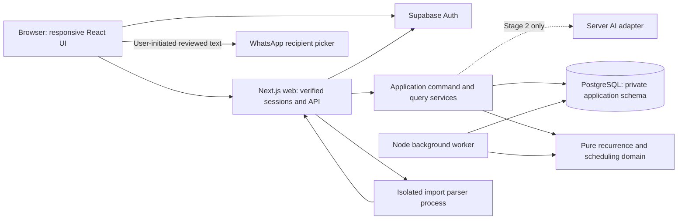

# DEV-03 — Application architecture and development workflow

**Status:** Complete — architecture and workflow specification. Application bootstrap, migrations, configured CI, and running services have not been created by this documentation task.  
**Priority:** P0 · **Owner:** Engineering · **Dependency:** DEV-01  
**Date:** 2026-11-05  
**References:** [Plan](PLAN.md), [Domain contract](DOMAIN_BEHAVIOR.md), [UX specification](UX_DESIGN.md), [Backlog](TASKS.md).

## 1. Repository baseline and scope

The repository currently contains the four planning/specification Markdown files. Inspection found Node.js 22.22.1 and npm 9.2.0, no package manifest, no application scaffold, and no usable Git repository (`git status` reported that the directory is not a repository). Do not treat the presence of a `.git` directory as a working checkout.

This document selects the stack, module boundaries, operational model, and commands the implementation must provide. Commands labeled as a script contract are not runnable in this documentation-only baseline. No packages were installed, paid resources provisioned, email sent, WhatsApp message sent, or deployment performed.

## 2. Selected stack

| Area | Decision | Reason for this application |
| --- | --- | --- |
| Runtime | Node.js 22, npm, TypeScript strict mode | One language for web, domain, import, and jobs; matches the inspected runtime family |
| Web | Next.js App Router with React; Node runtime for application APIs | Addressable responsive pages, server rendering, same-origin API boundary |
| Interface | Tailwind CSS, semantic HTML, accessible headless dialog/menu primitives from Radix UI | Implement UX components with consistent styles and keyboard behavior |
| Validation | Zod request/environment schemas and shared domain value types | Consistent typed input validation without trusting client-side forms |
| Database | Supabase-managed PostgreSQL | Relational history, constraints, atomic changes, and durable job records |
| Database access | `pg` with parameterized SQL and explicit transactions | Direct control over locks, revisions, occurrence uniqueness, and atomic batch imports |
| Migrations | Supabase CLI versioned SQL migrations | One migration history for local and hosted database environments |
| Authentication | Supabase Auth; verified email/password, sign-in, sign-out, password recovery | Accounts independent of assigned members; supports household invitations |
| Session integration | `@supabase/ssr` plus `@supabase/supabase-js` | Cookie-based Next.js auth integration with server verification |
| Dates | `@js-temporal/polyfill` behind a small date adapter | Explicit plain dates, instants, timezone-aware day boundaries |
| Jobs | PostgreSQL job/outbox tables, Node worker, leased execution and retry | Durable replanning and local-day reconciliation without another datastore |
| Hosting | Render Docker web service and separate Render background worker; Supabase database/auth | Long-running Node processes and a worker independent of open browsers |
| CSV | `csv-parse` streaming API | Quoting/encoding handling with bounded record parsing |
| XLSX | ExcelJS plus `yauzl` archive inspection | Typed workbook/formula inspection with explicit decompression limits |
| Checks | ESLint, TypeScript, Vitest, Playwright, accessibility checks in browser tests | Domain, integration, and real user-flow verification |
| CI | GitHub Actions when a Git remote is configured | Reproducible install, migrations, tests, and production build |
| AI | Server-only provider adapter, disabled in Stage 1 | Add suggestions later through the same authorized command services |

Select Next.js 16 and its compatible React release at bootstrap. Resolve patched compatible versions, pin the Node/npm toolchain, commit `package-lock.json`, and use `npm ci` afterward. Exact package patches are installation outputs, not invented lockfile contents in this document. The documented Next.js minimum is Node 20.9; the selected Node 22 family satisfies that requirement. [Next.js installation](https://nextjs.org/docs/app/getting-started/installation).

The hosting decision uses Next.js self-hosting and Render's continuously running background worker service. It does not depend on browser timers or request-lifetime background promises. Choose service sizes and colocated regions during deployment preparation, without assuming a free tier or quoting an unverified price. [Next.js self-hosting](https://nextjs.org/docs/app/guides/self-hosting), [Render background workers](https://render.com/docs/background-workers).

## 3. System boundaries



Use a modular monolith with two runtime entry points: web and worker. They share domain/application modules and database repositories. Neither process owns scheduling rules exclusively; both invoke the same pure functions. The worker receives durable job identifiers, not arbitrary executable instructions.

The browser uses Supabase for authentication only. Household data reads/writes go through the application's authorized server operations. No browser direct database writes, service-role keys, or privileged SQL credentials are allowed.

### Planned source structure

```text
src/
  app/                      Next.js pages, route handlers, auth callback
  components/               UX reusable components and screen compositions
  domain/
    dates/                  PlainDate helpers, timezone adapter, Clock interface
    recurrence/             Rule expansion and resolution anchors
    scheduling/             Eligibility, capacity, priority, forecasts, conflicts
    occurrences/            State transitions and undo dependency guards
    imports/                Normalized row validation and duplicate rules
    messages/               Deterministic text generation and source comparison
  application/              Household commands/queries and transaction orchestration
  infrastructure/
    auth/                   Supabase SSR verification and access adapters
    db/                     pg pools, SQL repositories, transaction helpers
    jobs/                   Outbox, leases, retries, local-day reconciliation
    imports/                CSV/XLSX child process, upload limits, file cleanup
    ai/                     Disabled adapter and future provider implementation
  worker/                   Poll/claim/run/reconcile/cleanup entry point
  server/                   Environment validation, logging, request guards
tests/
  unit/                     Pure domain examples and invariants
  integration/              Real local database/auth and concurrent transactions
  e2e/                      Browser journeys and accessible interactions
  fixtures/                 November 2026 household and bounded import files
supabase/
  config.toml
  migrations/               Timestamped SQL files
  seed.sql                  Local-only deterministic domain seed data
scripts/                    Local seed, worker build, environment validation
```

Enforce imports: domain cannot import React, Next.js, `pg`, environment variables, network clients, parser libraries, or AI libraries. Application services depend on domain and repository interfaces. Infrastructure implements those interfaces. Web and worker are composition roots. Use `server-only` guards for credential-bearing modules and restrict domain dependency imports in ESLint.

## 4. Identity, authorization, and secrets

Supabase account IDs identify users; separate household memberships grant application access; members receive assignments and optionally link to users. Household invitation tokens belong to application records, expire, are stored hashed, and cannot link an already-linked member twice. Invitation creation can produce a copyable URL; actual invitation-email delivery is a separate explicit action. Supabase Auth verification/recovery email is configured through its email system and production SMTP settings.

Use the documented SSR cookie refresh mechanism. Verify server claims on every protected operation; do not trust an unverified session object. Recheck live household membership inside the transaction for mutations and sensitive queries, including import commit and message freshness checks. Authenticated identity is necessary but not sufficient authorization. [Supabase SSR client guidance](https://supabase.com/docs/guides/auth/server-side/creating-a-client?framework=nextjs).

Keep domain tables in an `app_private` schema not exposed by the Supabase Data API. Revoke schema/table/default privileges from browser-facing `anon` and `authenticated` roles. Web and worker use dedicated server database roles with only the privileges their repositories require; migrations use a separate owner credential. Server repositories always scope queries to verified household membership and include household IDs in relationship constraints. Do not assume `auth.uid()` is set when using a direct `pg` connection. Test forged IDs and cross-household joins against the actual runtime role.

Keep authenticated household responses out of shared/CDN caches. Use same-origin mutation requests, origin/CSRF validation, secure production cookie settings, and rate limits for auth, upload, and expensive operations. Render text as text. Redact tokens, credentials, email links, file contents, instructions, and generated message bodies from ordinary logs. These controls belong at server boundaries, not in the scheduling engine.

## 5. Database access and transactions

Use PostgreSQL `date` for target/scheduled/performed dates, `timestamptz` for instants, integer minutes, UUID identities, and explicit revision columns. Store the performed-date/timezone/minutes snapshot instead of recomputing history from current settings. DEV-04 defines the actual migrations, indexes, and partial uniqueness constraints.

Use a small `pg.Pool` per web/worker process, initially at most five connections each; verify the total against the provisioned database's limits. Prefer a direct TLS connection; use Supabase's session pooler when the deployment network requires IPv4. Use a separate migration URL and do not disable certificate validation. Supabase documents session pooling as the IPv4 alternative for persistent clients. [Connection options](https://supabase.com/docs/guides/database/connecting-to-postgres).

Every command transaction:

1. Verify the user and lock/check household membership; worker jobs use their persisted household/system actor context.
2. Claim/check the idempotency identity and validate the request's expected record revision.
3. Lock affected domain rows in a consistent order and validate allowed transitions.
4. Apply facts, occurrence changes, and audit events atomically.
5. Increment the household **input revision**, mark the plan pending, and insert/coalesce a durable replan request in the same transaction.
6. Store the command result and commit. A lost response is resolved by idempotency readback, not by a new action.

Successful fact changes can precede successful replanning. Return command outcome, input revision, latest applied plan revision, and plan status separately. Do not hold a transaction open across AI calls, workbook parsing, or browser interactions.

For planning: read a consistent snapshot at input revision R, compute outside locks, then lock the household and apply only if its input revision is still R. Otherwise discard and recompute. Applying a plan increments its plan version, records source R and date context, and marks it current only if no newer input exists. Never let a stale worker restore an occurrence already completed by another user.

## 6. Jobs, local-day reconciliation, and synchronization

Use the transaction outbox as the durable queue. Claim due work using a short transaction with `FOR UPDATE SKIP LOCKED`; use job leases with expiry/heartbeat, attempt counts, backoff, and a failed state. Execution is at least once, so each handler must be idempotent. PostgreSQL documents `SKIP LOCKED` as useful for queue-like consumers. [PostgreSQL SELECT locking](https://www.postgresql.org/docs/current/sql-select.html).

Initial operational defaults: poll ready jobs every two seconds, heartbeat leased jobs every 15 seconds, expire a lease after 90 seconds without renewal, and retry failures up to five times with bounded exponential backoff. These are configurable worker settings, not product recurrence rules. Preserve failed work for operator retry and expose stale/failed planning to users.

The worker also performs a due-household scan every minute. Persist each household's next reconciliation instant and last reconciled local date. Determine due dates using its timezone, enqueue one idempotent reconciliation key per household/local date, and advance the cursor transactionally. Reconcile all missed local-day boundaries after downtime, preserving fixed histories and the single outstanding completion-based occurrence. Recompute the next instant after timezone changes. A small worker scheduling delay must not alter calendar-day semantics.

Run draft-expiry cleanup and horizon extension as durable periodic jobs. Web app opening can request a catch-up using the same job keys, so both paths coexist safely. Graceful shutdown stops claiming jobs and lets leases recover unfinished work; restarting the worker cannot lose acknowledged domain changes.

Stage 1 client synchronization uses version polling every 15 seconds while visible, immediate refresh after own changes, and refresh on focus/reconnect. Pause polling in hidden tabs. Poll a household summary endpoint, then refresh affected queries when revisions differ. Freshness-sensitive commands and message handoff revalidate on demand; polling alone never proves freshness. Realtime subscriptions can be added later without changing the domain contract.

## 7. Dates and deterministic development clock

Represent a plain date as validated `YYYY-MM-DD` and use `Temporal.PlainDate` for day/month arithmetic. Represent execution time as `Temporal.Instant`; derive household today and next midnight through a timezone adapter. Keep the polyfill behind this adapter so native support can replace it later. [Temporal polyfill project](https://github.com/js-temporal/temporal-polyfill).

Require an injected clock rather than `Date.now()` inside domain code:

```ts
interface Clock {
  now(): Temporal.Instant;
}
// today = clock.now().toZonedDateTimeISO(household.timezone).toPlainDate()
```

Composition roots select `SystemClock` or a test-only `FixedClock`. The same clock reaches commands, planner, reconciliation, expiry, and fixture setup. If `APP_ENV` is production or staging, reject a fixed clock at startup; clients cannot select time through a header/query. Browser tests use isolated test-environment controls, never a deployed public time-travel endpoint.

Baseline fixture: fixed instant `2026-11-03T10:00:00Z`, household timezone `America/Recife`, local date 3 November 2026. Sam is available Tuesdays and alternate Fridays anchored 6 November. Add separate timezone/DST fixtures, including a DST-observing household, month/year transitions, leap years, and missing monthly dates. Avoid global fake timers as a substitute for explicit domain time.

## 8. Bounded import architecture

Use Node route handlers with streamed multipart processing (`busboy`) and an explicit file-byte counter. The 5 MiB domain limit is enforced on file bytes, not just a client-reported Content-Length. Enforce a small multipart overhead allowance and authenticated per-user concurrency limits before starting expensive parsing. Do not route uploads through default-sized Server Actions.

Parse in a child process with a 10-second wall timeout, 128 MiB V8 heap ceiling, and a bounded result channel. These are initial operational budgets to measure with legitimate fixtures; a heap limit is not a full sandbox or a bound on all native memory. Apply container memory limits too. The child receives only upload input/options, no database or AI credentials, and no ability to fetch workbook references through application code. On timeout/error, kill it and clean its temporary file. Do not echo raw parser input in logs/errors.

- CSV: strict UTF-8 decoding, bounded record size (64 KiB), explicit column/row limits, standard quoting, and no locale inference. `csv-parse` exposes a maximum record-size option; the application must turn it on. [CSV parser option](https://csv.js.org/parse/options/max_record_size/).
- XLSX: inspect archive entries with `yauzl` lazy iteration, validate file names/sizes, reject encryption/macro content, and count actual decompressed bytes across the archive, stopping above 20 MiB. Do not trust only ZIP header sizes. Never extract archive paths into the filesystem. `yauzl` documents lazy iteration and entry-size validation; the aggregate byte budget is application logic. [ZIP library documentation](https://github.com/thejoshwolfe/yauzl).
- After bounded ZIP inspection, use ExcelJS to normalize selected-sheet values, dates, and formula metadata. Formula cells in mapped fields are invalid even when they have cached results; no workbook links are fetched. Add tests for the 1900/1904 date systems and reject ambiguous date values. The selected library supports XLSX and formula-valued cells; these import policies are application requirements, not default guarantees. [ExcelJS documentation](https://raw.githubusercontent.com/exceljs/exceljs/master/README.md).

For multi-sheet selection: first inspect names in a bounded request, discard server raw data, and keep the File object locally in the upload wizard. After sheet selection, re-upload that same file with its selected sheet and map intent. Parse again under the same limits. A page reload can require reselecting the file. Do not retain an unparsed workbook on the server while waiting for the user.

Store normalized review drafts in private PostgreSQL rows, expire within 24 hours, and delete after commit/discard. Keep only the committed batch metadata required by D09. Imported definitions and the replan request are one atomic transaction; a failed subsequent plan is retried without recreating the batch. No object-storage bucket is required for Stage 1.

## 9. WhatsApp handoff and message freshness

Select the official text-only click-to-chat form:

```ts
const url = `https://wa.me/?text=${encodeURIComponent(reviewedText)}`;
```

WhatsApp documents that this opens a contact selection flow without specifying a phone number. This validates the integration choice; browser/device compatibility remains DEV-42's live acceptance testing. [WhatsApp click-to-chat documentation](https://faq.whatsapp.com/5913398998672934).

Generate text from a current successful plan through a server query. Return member/date, source occurrence versions, content fingerprint, generated instant, and plan metadata. The fingerprint includes names, instructions, estimated minutes, priority, and membership of the list. It is a freshness aid, not an authorization token. An on-demand server check immediately before copy/open revalidates access and relevant content, even if the user customized the displayed text locally.

Keep edited message bodies in browser memory for the session, with the UX recovery area for regenerated text. Do not place drafts in household URLs, analytics, or server logs. Copy uses `navigator.clipboard.writeText` on secure contexts with selectable-text fallback. Only the explicit Open WhatsApp action sends reviewed text to the external WhatsApp URL.

Open handoff initially into a blank tab synchronously from the user gesture, then perform the freshness request and navigate only if it succeeds; sever the opener and close the blank tab on a blocked/stale result. Test popup-blocker behavior rather than assuming an async `window.open` works. An alternative is a verified explicit second-click link after freshness validation; recheck source changes before handoff.

Set a conservative product fallback threshold of 2,000 characters for the complete encoded URL, measured including the prefix; this is not a claimed universal WhatsApp limit. Above it, disable URL handoff with an explanation and provide the entire text for manual copy. Never truncate. Browser/clipboard failure retains preview. Show “Open WhatsApp” or “Message copied”; even a successful navigation does not prove delivery. No Business API, stored recipient number, webhooks, background send, or scheduled morning delivery is involved.

## 10. API and client contracts

Use JSON Node route handlers for domain queries/commands and multipart for import parsing. Server-rendered pages may invoke the same authorized query services directly. Do not duplicate domain decisions in React or AI prompts.

| Operation family | Contract |
| --- | --- |
| Commands | Expected revision + idempotency key; return acknowledged facts, input revision, plan status |
| Daily/calendar queries | Requested household-local date range/member; occurrence versus forecast tagged explicitly |
| Plan summary | Input/applied revision, plan version, last update, current/pending/failed |
| Import preview/commit | Household-scoped draft ID/revision, row selection, duplicate acknowledgments, stable commit identity |
| Message generate/validate | One member/date/options, source fingerprint/version set; ready/stale/empty/pending response |

Return stable domain error codes and field issues, with 401 for unauthenticated, 403/404 without cross-household disclosure, 409 for stale/concurrent/dependency conflicts, 413 for input limits, and 422 for invalid domain input. Use request IDs for recovery and logging, not internal exception text in user messages.

## 11. Local environment and bootstrap handoff

The first implementation change must create the scaffold and configurations described here before adding DEV-04's schema. Use the selected compatible package versions, npm lockfile, `.nvmrc`, `.env.example`, ignore rules, test configuration, worker build/start scripts, and Supabase local configuration. Initialize/version the repository with a configured remote as part of that bootstrap; do not overwrite protected metadata or silently create a nested checkout.

Prerequisites: selected Node 22/npm toolchain, Docker-compatible local container runtime, Git, and the pinned Supabase CLI installed as a dev dependency. Supabase documents local `init`/`start` and project-local CLI use. [Supabase local setup](https://supabase.com/docs/guides/local-development/cli/getting-started).

After the scaffold exists, the developer setup is:

```bash
npm ci
cp .env.example .env.local
npx supabase start
npx supabase status
```

Populate the local keys/URLs from the local stack output, not production credentials. Run migration/seed commands below, then `npm run dev` and `npm run worker:dev` in separate terminals. Open `http://localhost:3000`. Local authentication emails use the local mail inbox supplied by the stack. Seed sample accounts through the local Auth Admin API, never production hard-coded passwords or direct inserts into managed auth tables.

### Environment contract

| Variable | Visibility and purpose |
| --- | --- |
| `APP_ENV` | Server: development/test/staging/production; validates clock and seed guards |
| `APP_ORIGIN` | Server: allowed application origin and callback basis |
| `NEXT_PUBLIC_SUPABASE_URL` | Public authentication endpoint |
| `NEXT_PUBLIC_SUPABASE_PUBLISHABLE_KEY` | Public authentication client key; never a privileged secret |
| `DATABASE_URL` | Server: restricted application role, web process |
| `WORKER_DATABASE_URL` | Server: restricted job/domain role, worker process |
| `MIGRATION_DATABASE_URL` | Migration process only: owner credential |
| `SUPABASE_SECRET_KEY` | Server/admin provisioning only if needed; not part of normal browser queries |
| `LOCAL_AUTH_ADMIN_KEY` | Local test/seed process only; never a deployable seed credential |
| `CLOCK_MODE` / `FIXED_NOW` | System by default; fixed only in development/test |
| `AI_ENABLED` | Server boolean; false for Stage 1 |
| `AI_PROVIDER_API_KEY` | Optional server secret only when a future adapter is enabled |

Validate required variables at startup per process. Load `.env.local` explicitly for worker/CLI scripts (for example through a pinned dotenv runner); Next.js loading it does not configure another Node process automatically. Check only placeholder values into `.env.example`; ignore local env files, auth browser state, import fixtures containing real data, test traces, and build artifacts. Configure SMTP and auth redirect allowlists in the auth service, separately per environment.

## 12. Migration and script contract

Use SQL files in `supabase/migrations`; a single Supabase CLI history owns schema changes. Never mix ad hoc production dashboard edits with a separate ORM migration system. Local reset/replay and hosted deployment follow Supabase's migration workflow. [Database migrations](https://supabase.com/docs/guides/local-development/database-migrations).

| Required npm script | Implementation contract |
| --- | --- |
| `dev` | Next.js development server |
| `worker:dev` | Watch/restart worker with validated local env |
| `build` | Next production build plus compiled worker/parser/scripts |
| `start` | Production Next server honoring Render's port |
| `worker:start` | Compiled worker process; no development loader |
| `env:check` | Per-process required configuration and test-clock guard |
| `db:migration:new -- <name>` | Pinned Supabase CLI migration creation |
| `db:reset:local` | Reset/replay migrations locally only; explicitly destroys local data |
| `db:seed:local` | Idempotent sample accounts/members/chores; refuses nonlocal targets |
| `db:migrate:deploy` | Apply committed pending SQL via migration URL; never resets data |
| `lint` | ESLint including domain dependency boundaries |
| `typecheck` | TypeScript no-emit check |
| `test:unit` | Vitest pure domain and adapter tests |
| `test:integration` | Real local PostgreSQL/auth, independent test households |
| `test:e2e` | Playwright browser tests against local web and worker |
| `check` | Lint + typecheck + unit tests; no hidden production/network mutation |

These scripts must be implemented and exercised in the scaffold/implementation commits; listing them is not a passing test result. Local setup then uses `npm run db:reset:local`, `npm run db:seed:local`, and the two development processes. Reset must require an explicitly local database endpoint; it is never part of production startup.

For each schema change: create migration, review SQL, replay from empty local database, verify constraints and authorization with the runtime role, and test upgrade from prior schema fixtures. Prefer additive changes. Deploy migrations once through a controlled release job with migration locking before compatible application rollout; do not let both web and worker race to migrate. Roll back application images when compatible; repair schema with a forward migration or verified restore rather than destructive automatic rollback.

## 13. Automated checks and release workflow

Use [Vitest](https://vitest.dev/guide/) for pure functions and application tests; [Playwright](https://playwright.dev/docs/intro) for actual browser workflows. Map domain scenarios E01–E24 and UX R01–R13 to meaningful tests as their implementations land.

PR workflow, once Git/CI are configured:

1. Install the pinned toolchain and `npm ci`; validate placeholder env schema.
2. Run lint, typecheck, pure domain tests, and production build.
3. Start isolated local Supabase services; replay migrations and seed test-only fixtures.
4. Run transaction/authorization/import integration tests, including two simultaneous completions and stale plan writes.
5. Install Playwright browsers, start local web/worker, and run core mobile/desktop journeys with fixed clocks. Exercise keyboard controls and automated accessibility checks; do not claim automated checks replace manual review.
6. Upload sanitized failure traces/artifacts, stop local services, and prevent merge on failed required checks.

Test auth with the real local service rather than bypassing server verification. Keep test-only time controls inaccessible in staging/production. WhatsApp tests assert URL encoding, user-gesture handoff, fallbacks, and no schedule mutation using intercepted navigation; never send actual messages in CI. Live device validation in DEV-42 is a user-initiated preview/handoff check, not delivery automation.

Staging and production have separate Supabase projects, Render services, auth redirect origins, and secrets. Container images are built from a known commit/lockfile and deployed by immutable version to web/worker. Configure health checks, worker heartbeat/queue monitoring, failed-job alerts, pending-plan age, and import timeout metrics without logging household content. DEV-28 verifies restore and rollout procedures before release.

## 14. AI extension boundary

Stage 1 runs with AI disabled. Define an `AssistantGateway` interface accepting a minimized authorized household snapshot and returning typed proposals or explanations. A later provider adapter runs only on the server; credentials and provider-specific payloads never enter domain modules.

No model receives direct SQL access, queue control, or automatic commit authority. Accepted proposals invoke the same application commands with user identity, validated fields, expected revisions, and idempotency as direct edits. Scheduling remains the deterministic engine's responsibility. AI unavailability cannot block chores, imports, daily messages, or completion. Provider/model and SDK selection are explicitly deferred to DEV-29 because no AI integration ships in Stage 1.

## 15. Verification evidence and remaining implementation

Verified for this architecture task:

- Repository/runtime inspection and absence of executable application/package/working Git setup.
- Primary documentation supporting framework/runtime compatibility, Supabase SSR/local migrations, persistent workers, parser capabilities, date adapter, and the text-only WhatsApp handoff.
- Local Node URL-construction checks for Unicode, line breaks, reserved characters, text round-trip, absent recipient number, and the conservative full-URL length fallback.
- Markdown file links, code-fence balance, and cross-document DEV-03 references.

Not executed: dependency install, package compatibility build, local auth/database, migrations, job runner, automated application tests, hosted deployment, or actual WhatsApp browser/device handoff. These require the scaffold and dependent features. No test suite exists yet; documentation checks and the URL smoke check do not constitute application validation.

| DEV-03 acceptance criterion | Evidence/handoff |
| --- | --- |
| Framework/database/auth/jobs/hosting/AI boundary | Sections 2–6 and 14 |
| Domain logic separate from UI/AI | Sections 3, 7, 10, 14 |
| Documented setup/env/migrations/checks | Sections 11–13; explicit script contract and implementation boundary |
| Server-only secrets and deterministic clock | Sections 4, 7, 11 |
| Bounded import/draft storage and manual WhatsApp fallback | Sections 8–9; D09/D10 remain authoritative |

Next implementation step: bootstrap the documented repository/tooling contract, then execute DEV-04's persistent records and constraints using these boundaries. Exact package patches, configured provider resources/regions, production SMTP credentials, and live-device results are deployment/implementation outputs, not unresolved product behavior.
