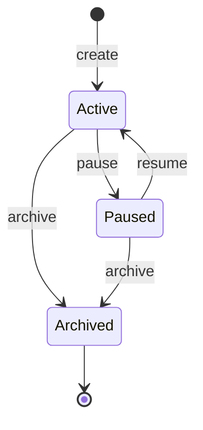
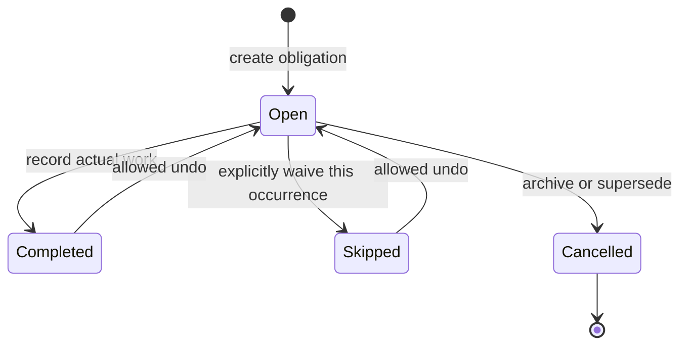
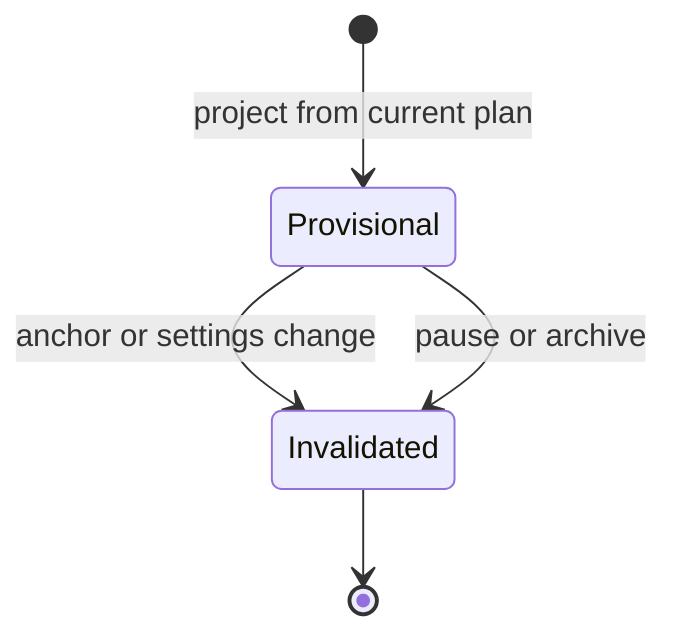

# DEV-01 — Domain behavior and edge cases

**Status:** Complete — domain specification; implementation belongs to later tasks.  
**Priority:** P0 · **Owner:** Product + engineering · **Dependencies:** None  
**Date:** 2026-11-05  
**References:** [Product plan](PLAN.md), [Developer backlog](TASKS.md).

## 1. Scope and authority

This specification defines the Stage 1 domain contract. The rules below resolve the defaults delegated to DEV-01; they are implementation decisions, not additional statements attributed to the user. Where this document clarifies a previously unspecified edge case, follow it together with PLAN.md. Record subsequent changes in both documents.

Use neutral terms: a **user** has application access; a **member** is a person who can receive assignments, with or without an account. All actors and referenced records must belong to the same household. Either authorized household user can manage any member's chores.

## 2. Domain vocabulary and invariants

| Concept | Definition |
| --- | --- |
| Chore definition | Versioned template containing recurrence, assignee, priority, estimate, and instructions |
| Occurrence | Independently addressable obligation with a stable ID and lifecycle status |
| Target date | Intended local calendar date; retained when scheduling moves work later |
| Scheduled date | Current planned execution date, nullable if unplaced or held |
| Completion | Auditable record of actual work, including performed date and recording user |
| Resolution anchor | Date used to derive the next completion-based obligation after completion or explicit skip |
| Forecast | Disposable projection of future completion-based work, not an actionable occurrence |
| Plan version | Household schedule revision used to detect stale writes |
| Definition revision | Effective version of a chore's settings; distinct from plan version |

Mandatory invariants:

1. An active completion-based series has at most one `open` occurrence, including held or conflicted work. Its successor may have a future target; it is still a real open obligation.
2. Each fixed occurrence belongs to a definition series and target date. Generation retries cannot create a second obligation for that identity.
3. Forecasts have no completion/skip endpoint and never become overdue obligations by passage of time. Actual obligations arise from series transitions or fixed-rule generation.
4. Completed, skipped, and cancelled records remain in history. No scheduler operation deletes them or fabricates a completion.
5. Scheduling cannot move fixed targets, alter completed history, borrow another member's capacity, or assign on unavailable dates.
6. All recurrence arithmetic uses local calendar dates, not multiples of 24 elapsed hours.
7. Every command checks household access, record version, and idempotency. A repeated successful request returns its existing result; a stale competing request returns a refreshable conflict.

## 3. Independent state dimensions

### 3.1 Chore lifecycle

| State | Behavior |
| --- | --- |
| `active` | Generate obligations and forecasts; allow planning, completion, and skip |
| `paused` | Hold existing open work; stop generation, scheduling, completion, and skip until resumed |
| `archived` | Cancel open work and remove forecasts; retain history; no further generation |

Archive is terminal in Stage 1. A user may create a new chore by copying settings; this creates a new series, not a restoration of old history.

### 3.2 Occurrence lifecycle

Persist exactly one of `open`, `completed`, `skipped`, or `cancelled`.

Terminal resolution records are retained when undone: append a reversal and make the occurrence open again. Do not erase the original event. Cancelled occurrences cannot be completed, skipped, or undone.

### 3.3 Placement, conflicts, and overdue indicators

These are independent of lifecycle status:

| Dimension | Values and rules |
| --- | --- |
| Placement for open work | `scheduled` with an accepted reservation; `unplaced` without a reservation; `held` while its chore is paused |
| Conflict | Zero or more structured reasons attached to open work; a conflict never means completed, skipped, or deleted |
| Overdue | `status = open AND target_date < household_today` |
| Missed scheduled date | Open work whose last scheduled day has ended without completion; triggers reconciliation |
| Forecast status | `provisional` only; separate record/view type, not an occurrence status |

A completion-based chore moved from Monday to Thursday can remain overdue Tuesday–Thursday. Rescheduling does not reset its target or disguise lateness. Held overdue work is shown in paused details, excluded from today's actionable list. A fixed overdue occurrence is retained for manual completion/skip but has no reservation on a past day.

Conflict codes include `UNAVAILABLE_DATE`, `RESTRICTED_DAY`, `DAILY_CAPACITY`, `WEEKLY_CAPACITY`, `FIXED_CAPACITY_CONFLICT`, `NO_ELIGIBLE_DATE_IN_HORIZON`, and `ESTIMATE_EXCEEDS_ALL_ELIGIBLE_DAYS`. Return all known reasons in stable order. Clear resolved reasons after a successful replan; retain prior reasons in schedule-change history.

### 3.4 Forecast lifecycle

Replanning replaces invalidated projections with fresh projections. A successor occurrence created after completion is a new obligation with its own ID, not a forecast changing status. Forecasts carry a source occurrence ID, definition revision, and plan version so stale UI entries can be discarded.

## 4. Command and transition decision table

| Command/event | Preconditions | State/data effect | Recurrence/capacity effect |
| --- | --- | --- | --- |
| Create completion-based chore | Valid active member, positive integer interval and minutes, explicit initial target | Active chore + one open occurrence | Plan from max(target, today) |
| Create fixed chore | Valid weekdays and active member | Active chore + fixed obligations within horizon | Attempt reservation on exact target dates |
| Schedule/replan | Active chore, open occurrence | Placement changes; status stays open | Apply availability, capacity, and priority; fixed targets remain fixed |
| Day ends with unfinished work | Open occurrence | Keep open and original target; log missed placement | Replan movable work; expire past reservations |
| Complete | Active chore, open occurrence, valid performer and performed date | Completed + completion snapshot | Charge actual date; derive completion-based successor |
| Skip | Active chore, open occurrence | Skipped + reason/actor/date | Release reservation; derive successor by rules below |
| Undo completion/skip | Reversible resolution and eligible dependencies | Reopen original; append reversal | Reverse capacity charge if applicable; cancel untouched successor; replan |
| Pause | Active chore | Paused; open work held | Release open reservations; discard forecasts; no new generation |
| Resume | Paused chore | Active; release held work under section 8 | Reconcile from today; regenerate forecasts |
| Archive chore | Active or paused | Archived; all open occurrences cancelled with reason | Release reservations; discard forecasts |
| Edit definition | Active or paused; expected revision matches | New revision and explicit affected-record set | Apply section 7; invalidate forecasts and replan |
| Archive member | Explicit disposition for every assigned active/paused chore | Archive member after atomic disposition | Reassign or archive affected chores; never leave hidden assigned work |
| Capacity/availability change | Valid effective date | Keep completed facts; update future eligibility | Replan; report conflicts rather than undo work |

Illegal transitions return a domain error without partial changes. Completing a forecast returns `FORECAST_NOT_ACTIONABLE`. Completing an already skipped/cancelled occurrence returns `OCCURRENCE_NOT_OPEN`.

## 5. Completion, actual work, and snapshots

- Record the occurrence ID, assignee at action time, actual performing member, recording user, performed local date, household timezone at recording, event timestamp, definition revision, and estimated minutes at completion.
- Default performer to the assignee; allow explicit selection of another active household member when recording work. This records actual work and does not reassign future chores.
- The performed date must not be in the future or before the chore was created. Backdated work must not precede the preceding completion/skip anchor in the same completion-based chain; reject inconsistent chronology.
- Permit truthful completion even when actual work occurred on an unavailable or over-capacity date. Show a warning and flag actual overload; do not reject historical facts or turn them into an automatic scheduling exception.
- Completion-based successor target is `performed_date + current_interval_days`. A backdated successor may already be overdue; create only one open successor and schedule from today onward.
- Fixed completion resolves only the selected occurrence. Later fixed targets and other overdue fixed occurrences remain unchanged.
- Checkboxes default to today; an explicit completion form allows correcting the performed date and performer before recording. Correcting a saved completion requires allowed undo followed by a new completion; arbitrary history editing is out of scope.

## 6. Skip and undo decisions

### D01 — Skip a completion-based occurrence without claiming work

Skipping means explicitly waiving this cycle. Record a skip event with a required reason, recording user, action date, and no completion record or consumed minutes.

Calculate a **skip anchor** as `max(skipped_occurrence.target_date, household_today_at_skip)`. The successor target is `skip_anchor + current_interval_days`. Link the successor to the skip event so it can be safely reversed. The last actual completion remains unchanged.

Examples:

| Situation | Result |
| --- | --- |
| Seven-day chore due Monday, skipped Wednesday | No work recorded; new target is the following Wednesday |
| Seven-day chore due next Monday, skipped this Wednesday | Skip that upcoming cycle; new target is seven days after next Monday |
| Fixed Tuesday occurrence skipped Wednesday | Only that Tuesday is waived; next Tuesday is unchanged |

The interface must preview the successor target before confirming skip. This deliberate skip is distinct from failing to complete a chore, which keeps the same occurrence outstanding.

### D02 — Undo only when it will not rewrite dependent decisions

For a completion-based series, allow undo only if:

1. The original chore is not archived and its recurrence series has not been superseded by a recurrence edit/type conversion.
2. No dependent successor has been completed or skipped, including a resolution later reversed. This conservative rule uses audit history, not just current status.
3. Descendants contain only disposable forecasts and at most one open, automatically derived successor. Assignee/priority/estimate edits alone are not blocking actions in Stage 1; reopen under current settings and preview any changes.

Cancel the untouched successor with reason `ANCESTOR_UNDONE`, discard forecasts, append a reversal of the original event, reopen the original target, and replan atomically. If paused, the reopened occurrence is held instead. Releasing a completion charge can alter both daily and weekly remaining capacity.

If a later occurrence has been acted on, return `UNDO_DEPENDENCY_CONFLICT` with the blocking occurrence IDs and leave all records unchanged. Stage 1 has no cascading undo or automatic deletion of later decisions.

For fixed chores, later occurrences are independent: undo an earlier completion/skip even if later dates were completed, unless the chore is archived. Reopen the original fixed target, applying current settings only if that occurrence was explicitly migrated by an edit. A past target becomes overdue, not rescheduled.

**Example:** A completed Monday creates B due next Monday. If B is still open, undo A cancels B and reopens A. If B was completed or skipped, undo A is rejected. For two fixed Tuesdays, undo of the first does not alter the second.

## 7. Definition edits and series revisions

Stage 1 chore edits take effect immediately on the household's current local date. Future-dated chore edits are deferred; availability edits support effective dates separately. Every edit records its actor, previous/new revision, and affected occurrence IDs. Completed/skipped/cancelled records keep their original snapshots.

| Edit | Outstanding work | Future work/history |
| --- | --- | --- |
| Name/instructions | Update open occurrences to current text | Forecasts use new text; history keeps resolved snapshot |
| Priority | Update all open occurrences, including overdue | Replan; never relabel historical priority |
| Estimated minutes | Update all open occurrences | Replan; completion charges keep minutes captured at completion |
| Allowed weekdays | Apply to all open work | Replan; fixed conflicts remain visible rather than moving dates |
| Assignee | Transfer all open occurrences, including overdue and held work, to selected active member | Release old reservations, evaluate new availability/capacity; future work uses new member; resolved history unchanged |
| Completion interval N → M | Preserve current open occurrence's target and ID | Recalculate forecasts with M; after its completion/skip, next target uses M; mark earlier series resolution undo as blocked by recurrence revision |
| Completion initial target | Allow only before the first completion/skip; explicitly replace the open target | Replan without changing history; afterward reject and direct user to a new series/type conversion flow |
| Fixed weekdays | Keep past-target open occurrences under old rule; reconcile today/future targets | Retain IDs for still-matching dates; cancel removed dates as `RULE_CHANGED`; create newly matching dates with stable identities |
| Completion ↔ fixed | Explicit preview/confirmation required; cancel all open work as `RECURRENCE_REPLACED`, including overdue | Start new series today; preserve all resolved/cancelled history; never migrate resolutions |

For type conversion to completion-based, require a new explicit initial target on or after today. For conversion to fixed, generate dates on or after today. Cancelling outstanding overdue work is shown in the confirmation; it is not silently marked skipped or completed.

If an edit removes then later re-adds a fixed date whose occurrence was cancelled, create a new series-generation identity linked to the cancelled record. Never reopen a terminal cancelled record or create two open obligations for the same chore/date. Define uniqueness on active logical obligations as well as generation identity.

Assignee edits do not change targets or recurrence anchors. If a chore moves to a person who is unavailable on a fixed date, show a fixed availability conflict. The scheduler never automatically transfers other chores in response.

**Example:** An overdue seven-day chore changes to every fourteen days. It remains due on its original target until completed or explicitly skipped. If completed Thursday, its next target is fourteen days after Thursday.

## 8. Pause, resume, archive, and member removal

### D03 — Pause holds work and does not fabricate catch-up cycles

At pause, preserve all open occurrences, mark their placement held, release reservations, and remove forecasts. Store the pause start local date. Generation and complete/skip actions stop; allowed undo can reopen held work.

On resume:

- Completion-based: retain the one outstanding target, even if overdue; do not create extra occurrences for the pause interval.
- Fixed: cancel still-open targets in `[pause_start_date, resume_date)` with reason `PAUSED_WINDOW`. Keep pre-pause overdue occurrences and existing targets on/after resume date. Generate missing future targets from resume date onward.
- A same-day pause/resume cancels no fixed dates. If an action occurred before pausing that day, preserve its history.
- Reapply current settings and capacity; do not backfill fixed dates that fell during the pause.

Archive cancels every open occurrence, including held/overdue work, with reason `CHORE_ARCHIVED`; records and resolutions remain readable. No undo of completion/skip is allowed after archive. The archive confirmation lists outstanding work being cancelled.

### D04 — Member archive requires explicit disposition

Reject archive with `MEMBER_HAS_ASSIGNED_CHORES` until the user chooses, for each active or paused assigned chore, either:

1. Reassign it and all its open occurrences to another active member; or
2. Archive the chore and cancel its open work.

Apply the selected dispositions and member archive atomically. Retain the archived member on historical completions and assignments. Do not silently transfer work to the current user. Archived members cannot be chosen for new assignments or newly recorded performance; existing historical records remain valid. Removing account access is a separate operation and does not archive the member or their chores.

## 9. Capacity accounting and fixed-date competition

### D05 — One work charge or one reservation per occurrence

For a member and local date:

`committed_minutes = completed_minutes + accepted_open_reservations + provisional_forecast_reservations`

Calculate daily and weekly totals from the same ledger. Historical completion minutes belong to the actual performer, not the recording user. Current reservations belong to the current assignee. Retain an immutable minutes snapshot when recording completion.

- Open scheduled occurrences reserve estimated minutes only on their accepted scheduled date.
- Unplaced, held, skipped, cancelled, and past-date open occurrences reserve zero current/future minutes.
- Completing an occurrence removes its reservation and adds exactly one completion charge on its performed date, in one transaction.
- Forecast reservations are soft, shown separately in future totals, and allocated only after real obligations. Invalidate them when real work requires the same capacity. Never count a forecast and its replacement obligation twice.
- An actual or approved load above a limit leaves zero automatic remaining capacity, not a negative allowance that can be borrowed elsewhere.

**Late fixed example:** A 45-minute fixed Tuesday chore is completed Wednesday. Its Tuesday reservation is removed; Wednesday receives one 45-minute completion charge. No additional Tuesday charge remains. The next Tuesday occurrence is independent. If Wednesday already contained 30 completed minutes against a 60-minute limit, display 75 completed minutes and replan outstanding movable work; never erase or reject the actual work.

### D06 — Deterministic competition among fixed chores

For today's and future dates, first deduct completed minutes and any existing explicit capacity-approved reservations. Then process fixed occurrences in ascending target-date order; within a date use high → normal → low priority, definition creation timestamp, and occurrence ID. Accept a whole occurrence only if both daily and weekly capacity remain sufficient. A non-fitting occurrence is unplaced with `FIXED_CAPACITY_CONFLICT`; continue evaluating other chores that may fit.

An accepted fixed reservation cannot be displaced by ordinary movable work, even if the movable chore has higher priority. Conflicted fixed work remains tied to its exact target, visible as requiring attention. Do not move it to a different day or pretend all competing fixed chores fit.

**Example:** Friday has 60 available minutes. Two fixed chores require 45 high-priority minutes and 30 low-priority minutes. Reserve 45; show the 30-minute occurrence as conflicted on Friday. A user can change the rule, assignee, or limit, skip the occurrence, or approve explicit excess capacity. If unchanged after Friday, the low-priority occurrence remains overdue without consuming future capacity.

### D07 — Explicit over-capacity approval is narrowly scoped

Approve a named occurrence for a named date and assignee, with actor, reason, estimated minutes, and excess daily/weekly minutes previewed. It may bypass capacity limits only, never availability, allowed weekdays, or a fixed target. Its full duration consumes capacity and leaves less or zero space for other work.

Revoke the approval if that occurrence is reassigned, moved, has its estimate changed, is completed/skipped/cancelled, or is held by pause. It never applies to the next recurrence. Approvals remain in audit history. If limits change later, retain the approval but recompute the visible excess; show actual values rather than an obsolete excess snapshot alone.

## 10. Timezone, calendar boundaries, and availability

### D08 — Timezone changes preserve calendar intent and recorded facts

- Store event timestamps as instants and target, anchor, performed, and scheduled dates as explicit local dates.
- A household timezone change takes effect immediately after a preview. Keep all stored date labels and recurrence anchors unchanged; do not reinterpret “Tuesday” as a different calendar date.
- Historical performed dates, captured timezone, and completion ledger dates remain unchanged. Do not derive them again from timestamps under the new zone.
- Compute today and future day-end triggers in the new timezone; cancel/replace old pending reconciliation jobs and run one idempotent catch-up.
- Replan all unfinished work. Dates that are now past can become overdue, but no new completion or skip is created.
- Availability weekdays, every-two-weeks anchors, and monthly selectors remain local calendar rules. A cancelled visit never moves a biweekly anchor.
- Validate a supported timezone identifier. Use calendar-date arithmetic across daylight-saving changes.

**Example:** A fixed Tuesday remains dated Tuesday after a timezone change. An event previously recorded as performed Monday stays Monday in history, even if its timestamp displays Tuesday in the new zone.

Changing the week start similarly preserves dates/history but rebuilds weekly capacity buckets and future planning. If the new buckets contain excess completed work, show it; do not change completions. Availability exceptions override recurring rules, and overlapping rules never add duplicate capacity.

## 11. End-to-end scenarios for implementation

| ID | Given / action | Required outcome |
| --- | --- | --- |
| E01 | High 45-minute Monday chore missed; Tuesday has normal 15 + low 45; daily limit 60 | High + normal occupy Tuesday; low moves to next feasible date; targets/history preserved |
| E02 | Member available weekly Tuesday plus Friday anchored every two weeks; target is an off-cycle Friday | Use next eligible working date with capacity; never create off-cycle Friday capacity |
| E03 | Completion-based A is completed Wednesday with interval 7 | A completed; one open B target Wednesday + 7; later entries provisional |
| E04 | A due Monday is skipped Wednesday with interval 7 | Skip only; zero completion charge; B target Wednesday + 7 |
| E05 | Undo A while B has only automatic scheduling | Cancel B, reverse A resolution, reopen A, discard old forecasts, replan |
| E06 | Undo A after B was completed or skipped | Reject atomically with dependency IDs; no historical changes |
| E07 | Two fixed Tuesdays completed; undo first | First reopens overdue; second remains completed |
| E08 | Late fixed completion crosses a week boundary | Release original reservation; charge actual performer in actual completion week's bucket exactly once |
| E09 | Interval edited while original work is overdue | Keep original target; use edited interval only for projected/successor work |
| E10 | Reassign open work to unavailable member | Move assignment explicitly, preserve target, show conflict/unplaced status; no automatic further reassignment |
| E11 | Archive assigned member without dispositions | Reject; no partial archive or lost chores |
| E12 | Pause across two fixed dates, then resume | Cancel uncompleted pause-window dates; retain pre-pause overdue and resume-date/future work |
| E13 | Convert recurrence type with overdue work | Confirmation lists cancellation; old work retained cancelled; new series starts from explicit current/future rules |
| E14 | Two fixed chores cannot both fit | Deterministic feasible reservations, visible remaining conflict, no silent overload |
| E15 | Complete despite actual unavailable/overloaded date | Preserve truthful completion and charge; flag actual overload; replan remaining work |
| E16 | Change timezone or week start | Preserve recorded dates and anchors; rebuild future day/week calculations and reconcile once |
| E17 | Repeat completion or run stale planner | Return prior idempotent result or version conflict; no duplicate successor or overwritten new plan |
| E18 | Edit estimate after completion | Completed charge stays at recorded minutes; only open work and forecasts use new estimate |

## 12. Remaining product choices and implementation boundary

No unresolved product choice blocks DEV-01 or Stage 1 domain implementation. The above rules are selected defaults and can be revised explicitly before dependent work ships.

Deferred choices, not implicit Stage 1 behavior:

- Cascading undo and correcting old completion facts after dependent work has been resolved.
- Restoring archived series, future-dated chore edits, and bulk historical edits.
- Early scheduling before targets and configurable interval tolerance windows.
- General calendar pins/moves, splitting chores, monthly chore recurrence, notifications, and reassignment suggestions (see Stage 3 tasks).
- Measuring actual duration; Stage 1 charges the estimate captured at completion.

Stage 1 has no user-created calendar pins. If that feature is added later, extend the reservation-order and conflict rules before implementation. Visual designs can explain these rules but cannot change their meaning silently.

## 13. Acceptance evidence for DEV-01

| Acceptance criterion | Evidence |
| --- | --- |
| States and allowed transitions | Sections 3–4: chore/occurrence/forecast diagrams, placement rules, command table |
| Occurrence versus overdue versus provisional status | Section 3: independent dimensions and formulas |
| Editing recurrence/assignee while retaining history | Section 7: edit decision table and series identity policy |
| Skip, dependent undo, timezone, member archive, fixed competition | D01, D02, D04, D06, D08 and examples E04–E16 |
| Late fixed capacity accounting | D05, late fixed example, E08 |
| Decisions, examples, remaining choices | D01–D08, sections 11–12; linked from PLAN.md and TASKS.md |

This task specifies behavior only. Automated domain tests are part of implementation tasks DEV-15–DEV-22 and DEV-43; no application or scheduling engine has been implemented here.

## 14. Feature extension — bulk chore import and daily messages

This extension adds the two requested Stage 1 features. The choices below are implementation defaults; existing occurrence, recurrence, household authorization, and historical-record rules continue to apply.

### D09 — Import files into reviewed chore definitions

Initial input formats: UTF-8 CSV and XLSX. Initial limits: 5 MiB per uploaded file, 500 nonempty data rows in the selected sheet, and a 20 MiB expanded XLSX parsing budget. Reject unsupported, encrypted, macro-enabled, malformed, or over-limit files with an explanation. Select exactly one worksheet for XLSX; ignore other worksheets. Treat cells as data: never execute macros, formulas, links, or embedded instructions. Flag formula cells in mapped columns as invalid rather than using cached results.

Provide a template and column mapping. The normalized schema is:

| Column | Requirement and interpretation |
| --- | --- |
| `name` | Required nonempty chore name |
| `member` | Required; select an active household member ID or unambiguously map a supplied name to that member |
| `priority` | Required; high, normal, or low |
| `estimated_minutes` | Required positive integer |
| `recurrence_type` | Required; completion_based or fixed |
| `interval_days` | Required positive integer for completion_based; empty for fixed |
| `initial_target_date` | Required for completion_based; ISO YYYY-MM-DD or a typed XLSX calendar date; empty for fixed |
| `fixed_weekdays` | Required for fixed; comma-separated mon/tue/wed/thu/fri/sat/sun tokens; empty for completion_based |
| `instructions` | Optional plain text |
| `allowed_weekdays` | Optional comma-separated weekday tokens restricting eligibility |

CSV fields containing commas must be quoted. Reject ambiguous date strings; do not infer locale. Normalize case/whitespace for enum matching and name suggestions while preserving display text. Show every normalized/defaulted value in preview. A user may explicitly apply a member or other shared field to selected rows; never silently fill a required field or create a new member from a name. Reject unknown columns unless the user explicitly leaves them unmapped. Missing required mappings block validation.

| Import state | Allowed action/result |
| --- | --- |
| `uploaded` | Parse within limits, choose sheet, map columns; no chores created |
| `review` | Edit row drafts, map members, validate, select/exclude rows, acknowledge possible duplicates |
| `committing` | Freeze selected valid rows and commit identity; disable a second submission |
| `committed` | Return stable created chore IDs/count; request one household replan |
| `discarded` / `expired` | No further commit; upload again if needed |

Parsing failure leaves no definitions and can be retried with a new file. Validation failure stays in review. A database failure rolls back the entire selected batch and returns it to review, unless commit outcome is unknown; then retrieve by commit identity before retrying.

Commit only the explicitly selected valid rows, atomically. Invalid rows may be corrected or explicitly excluded; they cannot be silently dropped. Revalidate member activity, access, and chore constraints at commit time. If these changed, return affected rows for review without creating a partial batch. Create active definitions using normal validated creation operations and normal initial occurrence generation; no row records a completion or directly overrides a scheduled date.

An exact normalized row repeated in the file or a same-member/same-normalized-name match against an existing nonarchived chore is a possible duplicate. Show matching rows/chores and require exclusion or explicit “Create separately” acknowledgment for selected warnings. This is a warning heuristic, not a uniqueness guarantee. Do not overwrite existing definitions. A later independent upload undergoes duplicate review again; retrying the same commit returns the original result without duplication. Changed row selections require a new commit identity after the prior result is known.

Retain raw file data only for parsing, then discard it. Retain household-scoped normalized drafts for up to 24 hours or until discard/commit; remove drafts afterward. Keep minimal committed batch metadata (actor, timestamp, count, created IDs, idempotency identity) for audit/retry without retaining the file contents. Long-term retention of a copied import file is not required.

**Example:** A file has ten rows: one ambiguous member and one possible duplicate. The user maps the member, excludes the duplicate, reviews nine selected rows, and commits. Exactly nine definitions are created. A retried request returns those same nine IDs. The resulting plan can show capacity conflicts; successful import does not promise every chore fits.

### D10 — Generate a message from one member's daily plan

Generation is read-only and available to authorized household users. Inputs are one active member ID, one local date within the eight-week planning window, and an include-instructions option defaulting to enabled. A member does not need an account, phone number, or WhatsApp linkage. Past-date message generation is outside Stage 1; history remains the place to inspect past work.

Use only real open occurrences with accepted scheduled placement on the selected date and current assignment to the selected member, from active chores. Include an overdue completion-based occurrence if it is now scheduled on that date. Exclude forecasts, completed/skipped/cancelled work, held work, unplaced fixed conflicts, and overdue fixed work from other dates. List relevant exclusions as website warnings, not as tasks inside the outgoing message. Do not add unscheduled chores merely because the person is available.

Sort high → normal → low, then target date and stable occurrence ID. Generate deterministic plain text: member + full date heading; numbered names, priority and estimated minutes; optional instructions; and total included estimated minutes. No account links, other members' lists, household access tokens, or completion controls appear in the message. Render names/instructions as plain text, not executable markup.

Message lifecycle: `draft` → `ready` after a current-plan check; `ready` → `stale` on relevant source changes; regenerate to replace the generated body after review. Local editing returns the preview to draft until checked again. The user can copy the reviewed text or explicitly open a WhatsApp sharing flow, select a recipient there, and send it themselves. There is no `sent` or `delivered` application state and no unattended delivery. Opening WhatsApp does not prove that the user sent anything.

Keep drafts session-local; changing member/date requires confirming replacement of edited text. Retain the prior edited text in a visible recovery area until the user discards it, so regeneration never destroys unsaved customization silently. Message edits are presentation only and cannot create, complete, reassign, or reschedule chores.

At generation and immediately before copy/open, require a current successful plan. Compare member/date, source IDs and versions, membership, and relevant plan content. If a plan version changed but the selected daily content is identical, refresh metadata without discarding edits. If relevant chores, instructions, duration, placement, or lifecycle changed, disable sharing and require a reviewed regeneration. Unknown/offline/pending/failed planning states cannot be labeled ready. Changes after external handoff cannot be recalled; show the generation timestamp and “Snapshot — check for later schedule changes.”

For no matching chores, show an empty state and disable chore-message sharing; never substitute another date or person. For unsupported/blocked WhatsApp handoff or excessive text length, keep the full preview and offer copy/manual selection. Do not truncate chores silently. Clipboard failure offers selectable plain text. Provider-specific handoff details are an implementation decision to validate in DEV-03/DEV-42, not a dependency on a WhatsApp messaging API.

**Example:** On a working Tuesday, generate Sam's message with two remaining scheduled chores totaling 60 minutes. A forecast for next Tuesday and Jordan's tasks are absent. If one of Sam's chores is completed before copy, the preview becomes stale and must be regenerated. Copying or opening WhatsApp changes no occurrence and records no delivery.

### Extension acceptance scenarios

| ID | Action | Required outcome |
| --- | --- | --- |
| E19 | Upload ten rows, resolve/exclude errors, commit nine twice using the same identity | Nine definitions total, no partial import or duplicate retry |
| E20 | Attempt wrong-household member mapping or unsupported/formula/over-limit input | Explicit error; no unauthorized records, formula execution, or partial chores |
| E21 | Generate for member without account on a working date | Only their real remaining scheduled chores, readable text and correct total |
| E22 | Relevant completion/reassignment happens before handoff | Stale preview blocks copy/open until reviewed regeneration |
| E23 | Generate on off-cycle date with no placed work | Empty state; no invented chores or automatic date substitution |
| E24 | Edit message, copy, or open WhatsApp | No schedule mutation, account provisioning, or claim of delivery |

PDF/image extraction, AI interpretation of unstructured files, import updates to existing chores, saved phone numbers, saved message archives, scheduled sending, and delivery tracking are deferred. CSV/XLSX and manual sharing are the selected first-release defaults.
