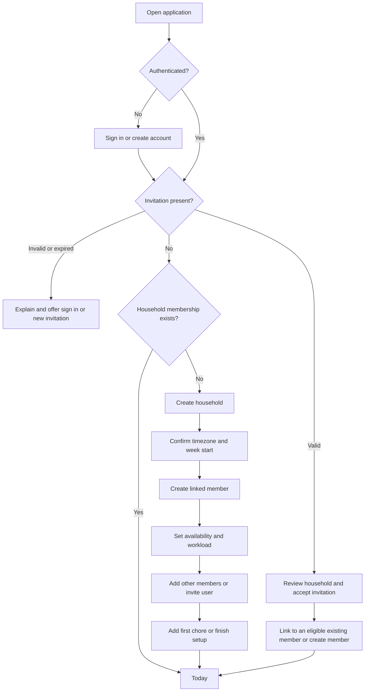

# DEV-02 — Application flows and reusable screen states

**Status:** Complete — design specification and wireframes; application implementation remains in later tasks.  
**Priority:** P0 · **Owner:** Product design + frontend · **Dependency:** DEV-01  
**Date:** 2026-11-05  
**References:** [Product plan](PLAN.md), [Domain behavior](DOMAIN_BEHAVIOR.md), [Backlog](TASKS.md).

## 1. Design scope and principles

Deliver a calm household workspace that answers: what needs doing, who is responsible, what fits, and why the plan changed. This document supplies reviewable low-fidelity layouts, interaction flows, component contracts, responsive rules, example copy, and screen-state requirements. It is not a rendered prototype or a claim of completed usability testing.

Use neutral member names and terms throughout. A **member** receives assignments; a **user** has account access. Never infer a relationship, gender, occupation, or account permission from a person's name or avatar. The interface must follow DEV-01; visual simplification must not collapse distinct domain states.

Stage 1 includes authentication, onboarding, Today, calendar, chore management, reviewed file import, daily message preparation for manual WhatsApp sharing, availability, workload, conflicts, and history. AI assistance is Stage 2. General calendar dragging, pins, reminders, and subtasks are not Stage 1 controls.

## 2. Information architecture and application shell

| Destination | Route proposal | Main action |
| --- | --- | --- |
| Today | `/today` | Complete a chore |
| Calendar | `/calendar?view=week&date=…&member=…` | Inspect a day or occurrence |
| Chores | `/chores` | Add chore |
| Household | `/household` | Manage members, availability, workload, invitations, and household settings |
| History | `/history` | Review work and schedule changes |
| Chore details/editor | `/chores/:id`, `/chores/new`, `/chores/:id/edit` | Inspect or edit a definition |
| Occurrence details | `/occurrences/:id` | Complete, skip, or inspect one obligation |
| Member setup | `/household/members/:id` | Edit availability and limits |
| Import chores | `/chores/import` | Upload, map, review, and confirm a batch |
| Daily message | `/messages/new?date=…&member=…` | Preview/edit text, copy, or open WhatsApp |

Routes are design proposals, not an architecture/framework selection. Details can appear in a desktop side panel while keeping an addressable destination and a full-screen mobile equivalent.

Desktop uses a 224px sidebar and a flexible content area, with an optional 360px details panel when space permits. Header shows household name, household-local date context, and account menu. Do not imply multiple-household switching is implemented.

Mobile uses four labeled bottom destinations: Today, Calendar, Chores, Household. History is a visible link in Household and the account menu. Honor safe-area padding; keep form actions above navigation or hide navigation within full-screen editors. Tablet uses the mobile shell until a sidebar and main content fit comfortably.

Person filters use **Everyone**, **Me**, then named members. Me resolves to the signed-in user's linked member, never to their account ID. Hide Me with an explanation if no member is linked. Defaults are Everyone on first visit; subsequent visits retain the chosen filter per user. Carry the filter between Today and Calendar. Store calendar view/date/filter in the URL so Back restores context. Household settings always show the member being edited explicitly.

## 3. Visual and interaction foundations

| Foundation | Design decision |
| --- | --- |
| Surface | Warm background `#FAF9F6`, white cards, subtle neutral borders |
| Text | Main `#18251F`, secondary `#52615A`; readable system sans-serif |
| Accent | Deep green `#215D45` for primary actions; blue/amber/red used with text and icons for information, warning, and errors |
| Type | 16px body; 14px secondary text; 24–32px screen titles; no essential tiny labels |
| Spacing | 4px base scale; 16px mobile gutters; 24–32px desktop content gaps |
| Controls | Visible labels, clear focus outlines, at least 44px intended touch area |
| Shapes | 10–12px card radius; restrained shadows for overlays only |
| Motion | Brief feedback; respect reduced motion; avoid animated list reordering during interaction |

Colors are starting tokens; verify actual foreground/background pairs during frontend implementation. Member colors identify people, never priority. Always include member name/initials. Priority uses labeled badges: **High**, **Normal**, **Low**. Forecasts use dashed borders plus the word **Forecast**; overdue entries use an alert icon plus target-date text. Avoid color-only meanings.

Place one primary action per form. Prefer explicit labels such as “Save availability,” “Skip this occurrence,” and “Archive chore.” Use full local dates when ambiguity matters and always show the household timezone in settings and date-sensitive confirmations.

## 4. Core user flows

### F01 — Create or join a household



Invitation acceptance must not silently create another household or link to an already-linked member. Keep the pending invitation through authentication. Onboarding is resumable. Invitations and first chore entry are optional; availability and limits must be explicitly configured before automatic placement for a member. Show “Setup needed” instead of assuming unlimited capacity.

### F02 — Complete a chore and inspect the revised plan

Today → select person → check occurrence → pending confirmation → saved completion → schedule updating → updated rows/workload + Undo + “View changes.” The quick checkbox records today and defaults performer to the assignee. “Record completion details” in occurrence details allows another performer or a past date.

Do not render an unconfirmed action as final. Keep the row in place while pending and disable repeated submission for that occurrence. After acknowledgment, show its checked state in a collapsible Completed today section. Announce changes before replacing shifted rows and keep keyboard focus stable. Undo remains accessible in details/history after the transient message disappears, subject to domain eligibility.

### F03 — Configure mixed availability

Household → named member → Availability → Add rule → choose repeat pattern → select weekdays/anchor → inspect preview → choose effective date → save → schedule updating → change summary.

Add a weekly Tuesday rule and a separate every-two-weeks Friday rule; do not force the entire schedule into a single recurrence selector. Exceptions use a date-specific editor and never change the Friday anchor.

### F04 — Resolve insufficient capacity

Today attention count or calendar conflict → occurrence details → read reasons → choose Edit limits, Edit availability, Edit chore/assignee, Skip, or Approve capacity exception → preview consequences → save → replan → resolved or still-conflicted result. Never advertise an override when the conflict is availability or a fixed date restriction.

### F05 — Import multiple chores from a file

Chores → Import chores → download template or select CSV/XLSX → choose worksheet if needed → map columns → match members → review/edit rows → resolve errors or explicitly exclude rows → acknowledge duplicate warnings → review selected count → Create N chores → import result and schedule update. Parsing alone creates nothing. Use the standard chore form vocabulary and recurrence helpers rather than introducing a second kind of chore.

### F06 — Prepare a daily message

Today, selected calendar date, or member profile → Create daily message → select one member and today/future date → generate current-plan preview → optionally edit text/instruction inclusion → check freshness → Copy message or Open WhatsApp → user chooses recipient and sends externally. Account access and phone number are not required for the selected member. Do not add a delivery/sent confirmation on returning to the website.

## 5. Screen layouts and behavior

The wireframes show content hierarchy, not final styling. Bracketed items are controls; symbols are supplemented by visible text in the actual UI.

### S01 — Authentication and onboarding

Desktop: centered, single-column card with household invitation context above the authentication form. Mobile: full-width form with generous padding and no app navigation until access is established. Authentication-provider details remain DEV-03's choice.

```text
Our Home
Join “Maple Home”                      (only for invitations)
Sign in / Create account
[Authentication fields or provider control]
[Continue]
[Recover access]                       (if applicable)
Inline error / expired-invitation explanation
```

Onboarding uses a visible step label: Household → Your member profile → Availability & workload → Other members → Finish. Preserve saved steps on reload. Each member row says “Account linked,” “Invitation pending,” or “No account access.” Add-member form asks Name and “Will this person access the app?” Selecting No hides email/invitation fields. Linking access later must not duplicate the member.

Empty: “No household yet” with Create household and invitation guidance. Expired invite: show the household name only when permitted by the invitation system; offer a new-invitation request path without automatically sending messages. Already accepted: open the existing household. Session errors preserve safe form context and return to the original route after sign-in.

### S02 — Today

```text
SIDEBAR | Today · Monday, 2 November       [Add chore]
        | [Everyone v] [Me]   Schedule current
        | Alex: 45 / 60 min today · 120 / 240 min this week
        | Jordan: …                  Sam: …
        | TODAY — Alex
        | [ ] Clean bathroom       High · 45 min       [Details]
        |     Due today · Every 7 days after completion
        | [ ] Water plants         Normal · 15 min     [Details]
        | COMPLETED TODAY [expand]
        | OVERDUE FIXED CHORES (1)                     [View]
        | NEEDS ATTENTION (2)                          [View]
        | PLAN CHANGES: 1 chore moved                 [View changes]
```

Member groups show name/avatar, totals, and rows sorted high → normal → low, then target, with stable ties. Do not re-sort while a row has focus or a request is pending. A scheduled overdue completion-based chore appears once in its scheduled section with its old target shown, not duplicated in the overdue-fixed list. Unplaced movable work appears in Needs attention, including work beyond the horizon. Held work belongs in paused chore details, not today's checklist.

Mobile: one-column cards; filter above list; member workload summary collapses to the selected person or an expandable member list for Everyone. Do not show a single pooled household capacity bar that implies transferable capacity.

No chores: “Nothing scheduled for today.” Offer Calendar and Add chore. If attention work exists, retain it and say “There are still 2 chores needing attention”; never claim all work is complete. No filter results: name the selected person and offer Everyone. Completed-only day: show “Today's scheduled chores are complete” while retaining attention/overdue sections.

### S03 — Calendar: week, month, and mobile agenda

```text
Calendar            [Previous] [Today] [Next]   [Week | Month]
2–8 November 2026    [Everyone v]              [Add chore]
Mon        Tue        Wed        Thu        Fri        Sat Sun
Alex       Sam        Alex                  Sam
[chore]    [chore]    [Forecast]              [chore]
45/60 min  …          …                     …
------------------------------------------------------------
Selected day details / conflicts / workload by person
```

Week: seven date columns when space allows, stacked member entries and expandable capacity totals. Month: up to three readable entries per day followed by “+N more”; selecting it opens that day's agenda. A conflicted fixed entry stays on its target date with “Not scheduled — capacity conflict,” without implying a reservation. Unscheduled movable work stays in a visible attention panel outside the date grid.

Mobile: date strip + selected-day agenda for week mode; compact month date grid + agenda below for month mode. Navigation retains selected member. Every overflow entry remains reachable without dragging or precision gestures. Offer a list/agenda alternative to the desktop grid for keyboard and screen-reader users.

Forecast entries say “Forecast — may change” and omit checkboxes, Complete, and Skip. Open details may link to the real outstanding occurrence or definition. Browsing beyond eight weeks shows “Schedule preview available for the next 8 weeks,” not a misleading empty calendar or invented entries.

Selected occurrence details open in a desktop panel or full-screen mobile page, with Back returning to the same view/date/filter. Show title, assignee, status, priority, duration, target, scheduled date, recurrence, instructions, and latest change reason. Explain a moved target: “Target: Monday · Scheduled: Thursday · 3 days after target.”

### S04 — Chore list and form

List: search, assignee filter, Active/Paused/Archived tabs, Add chore, secondary Import chores action, and rows with recurrence, priority, estimate, and member. Search only affects this list, not the calendar's person filter. Archived definitions are read-only with Copy as new chore.

```text
Add chore / Edit chore
Name [________________________]
Instructions [________________]
Responsible person [Select v]
Priority [High | Normal | Low]    Estimate [45] minutes
Recurrence:
 (•) After completion   ( ) Fixed weekdays
 [Every 7 days]         OR [Mon Tue Wed Thu Fri Sat Sun]
 Initial target [date]  (for completion-based creation)
 Optional restrictions [Allowed weekdays]
 Recurrence example / validation messages
 [Cancel]                                      [Save chore]
```

Completion-based helper: “The next target is 7 days after completion. Availability and workload may move the scheduled date later.” Fixed helper: “Future Tuesdays stay fixed even if one occurrence is completed late.” Disable initial-target editing after the first completion/skip and explain why. Fixed rules start generating current/future matching dates, without offering a completion-based initial-target control.

Use inline field errors plus a focused error summary after failed submission. Preserve entered values on failure. A fixed weekday outside availability produces a warning with affected dates; allow saving the definition with a visible conflict rather than silently changing the weekday. Zero/invalid duration, invalid interval, and no fixed weekdays are validation errors.

Edit review summarizes impacted open work and leaves historical work untouched: “Reassigns 2 open occurrences to Jordan”; “Current target stays Monday; the next interval becomes 14 days.” Switching recurrence type requires a second-step confirmation listing cancelled open occurrences, including overdue work, and the new series start. Do not use a generic “Are you sure?” dialog.

Mobile: stacked fields, full-screen editor, sticky Save/Cancel actions with no overlap with keyboard/navigation. On leaving a dirty form, offer Keep editing or Discard changes. A successful save may show “Saved — updating schedule” before final placement is available.

### S05 — Household and member profile

Household overview shows named member cards with access state, availability summary, daily/weekly limits, and Setup needed indicators. Primary actions: Add member and Invite user. Each profile has Availability, Workload, and Access sections. Household settings contain timezone and week start with impact previews.

Member archive opens a list of assigned active/paused chores. Each requires Reassign to selected member or Archive chore. Block final archive until all have dispositions. Explain cancelled work and retain historical attribution. Removing account access is a separate labeled action, not member archive.

### S06 — Availability editor and working-date preview

```text
Sam · Availability
RULES                                     UPCOMING WORKING DATES
Every Tuesday                             Tue 3 Nov · 180 min
Effective from 3 Nov 2026     [Edit]       Fri 6 Nov · 180 min
Every 2 weeks on Friday                   Tue 10 Nov · 180 min
Anchor: Fri 6 Nov 2026        [Edit]       Tue 17 Nov · 180 min
[Add rule]                                Fri 20 Nov · 180 min
                                         Tue 24 Nov · 180 min
EXCEPTIONS                               No visit: Fri 13 Nov
[Select date] [Unavailable / Extra date]
Optional daily limit override [minutes]
Changes apply from [date]
[Cancel]                                 [Save availability]
```

The fixture uses a weekly Tuesday rule effective 3 November 2026 and a Friday rule anchored 6 November 2026. Preview headings label these as example dates, not today's live schedule. Clearly state: “Two separate rules combine. One week: Tuesday and Friday. Next week: Tuesday only.”

Rule builder fields:

| Pattern | Fields | Summary/validation |
| --- | --- | --- |
| Weekly | Selected weekdays, effective start, optional end | “Every Tuesday” |
| Every 2 weeks | Weekday, first working date/anchor, effective start, optional end | “Every other Friday, anchored 6 Nov”; anchor must match weekday |
| Monthly by date | Day 1–31, start, optional end | “On the 15th”; missing dates skip that month |
| Monthly by weekday | First/second/third/fourth/fifth/last, weekday, start, optional end | “First Friday”; absent fifth weekdays skip that month |

Use “Every 2 weeks,” not “twice a month.” Explain that monthly means calendar months, not four weeks. The anchor sets the two-week cycle; the effective start limits which matching dates apply. Rule cancellation/end never reanchors another rule.

Preview lists actual dates for eight weeks and permits selecting another month for rule inspection; this is an availability preview, not an extended chore forecast. Combine overlaps into one date. Mark exceptions explicitly: “Cancelled visit” or “Extra working date.” A date override is edited in place rather than allowing contradictory exceptions.

Mobile: rule cards above the preview, with a persistent “Preview dates” link; exception date selection opens a full-screen date picker. Rule edits remain drafts until Save availability. Backend-computed preview is the source of truth; stale/failed preview blocks saving only when the rules themselves cannot be validated, and otherwise clearly reports preview unavailable rather than inventing dates.

### S07 — Workload settings

```text
Sam · Workload
Daily limits (minutes on available dates)
Mon [0]  Tue [180]  Wed [0]  Thu [0]  Fri [180]  Sat [0]  Sun [0]
Weekly limit [300] minutes
Example week A: Tue + Fri → at most 300 min total
Example week B: Tue only  → at most 180 min total
[Preview affected chores]
[Cancel]                                      [Save workload]
```

Do not conflate a zero limit with an unavailable recurrence rule: explain both independently. Daily limits apply only when a date is available. Show unused weekly capacity does not carry forward. Date overrides are accessible from availability exceptions. Limits accept nonnegative integers; estimates require positive integers.

Usage displays completed, reserved, and forecast minutes separately: “30 completed + 15 planned / 60 min” and, in future previews, “+15 forecast.” A progress bar never hides excess: show “75 / 60 min · 15 min over” with text, even if the visual bar is capped. Show completed work counted against the actual performer, not the recording user.

Lowering limits below completed work is allowed; preview the resulting overload and explain that history stays unchanged. Do not label a schedule feasible while replanning is pending.

### S08 — Attention and change review

Use a shared attention list accessible from Today, Calendar, and member profiles. Each item shows member, chore, target, duration, primary reason, additional reasons, and recommended actions. Selecting it opens the real occurrence rather than a duplicate UI-only task.

| Reason | User-facing copy | Actions |
| --- | --- | --- |
| No availability | “No eligible working date in the next 8 weeks” | Edit availability, edit restrictions |
| Daily limit | “This 90-minute chore exceeds the available daily capacity” | Edit estimate or limits; inspect other reasons |
| Weekly limit | “Weekly capacity is already committed” | Review week, edit limits |
| Fixed conflict | “Must stay on Friday; not enough capacity” | Edit rule/assignee/limits, skip, eligible capacity exception |
| Repeated postponement | “This chore has been postponed repeatedly” | Review chore or priority |

Multiple reasons can coexist; do not promise one action will resolve all of them. Unplaced work does not count as a reservation.

Change review shows before/after date, member, and explanation: “Organize shelves: Tuesday → Wednesday. Moved to make room for overdue bathroom cleaning.” Completed historical changes stay visible without proposing to undo their history. No “Accept plan” step is required for ordinary automatic replanning under saved rules.

Capacity exception confirmation names the occurrence, person, exact date, daily/weekly excess, and required reason. Explain that it applies once and does not change ordinary limits. Do not offer this action to bypass unavailable dates or fixed-day restrictions.

### S09 — History

Chronological list with member, chore, date-range, and event-type filters. Desktop may use a compact table; mobile uses cards. Each completion shows “Performed by Sam · Recorded by Alex,” performed local date, recorded timestamp, and estimated minutes snapshot. Schedule changes show before/after dates and reasons. Reversed events remain labeled “Undone”; skips never use a completed checkmark.

Eligible completion/skip entries expose Undo. Ineligible entries show the reason and links to blocking later occurrences, not an unusable unexplained control. Archived member names and chore snapshots remain readable. Empty filter results offer Clear filters; no history yet explains where future events will appear.

### S10 — Import chores wizard

Desktop uses a stepped full-page wizard with a scrollable review table; mobile uses stacked row cards with a focused row editor. File selection must have a labeled button, not require drag-and-drop. Show supported formats (CSV/XLSX), 5 MiB/500-row limits, downloadable template, and no-changes-before-confirmation guidance before upload.

```text
Import chores               Upload → Map → Review → Confirm
[Choose file] [Download template]
Worksheet [Household chores v]       (XLSX only)
Map “Person” → Responsible member [v]
Map “Frequency” → Interval days [v]
REVIEW: 10 rows · 1 error · 1 possible duplicate
[x] Bathroom | Sam | High | 45 min | Every 7 days | [Edit]
[ ] Shelves  | Unmatched member              | [Resolve]
[x] Plants   | Possible existing match       | [Review]
[Back]                            [Review selected chores]
CONFIRM: Create 9 chores; exclude 1 row
[Back]                                    [Create 9 chores]
```

Display field errors next to cells/cards and provide jump-to-error navigation. Member matching offers only active household members; ambiguous names require explicit selection. Duplicate review shows the matching chore and Exclude / Create separately choices; do not default to overwrite or silently discard a row. Shared-field fill requires an explicit selection and shows resulting values.

Confirm requires all selected rows valid and duplicate warnings acknowledged. Excluded rows and counts are visible; errors in excluded rows do not block valid selected rows. During commit disable repeated submission. Results show created IDs/count, “Updating schedule,” then a link to the chore list and scheduling conflicts. A failed schedule update after successful import retries only planning, not creation. Lost commit responses enter readback/recovery, not a fresh import.

Unsupported/encrypted/formula/malformed/oversized file states provide specific next steps and keep the template available. Draft expiry offers upload again with no claim that chores were created. On discard, explain only unsaved draft rows are removed. Warn on leaving unsaved review edits.

### S11 — Daily message composer

Today and a selected calendar day expose a secondary Create daily message action; a member profile provides the same entry. If Everyone is selected, require a specific person rather than generating a household-wide message. Use today's date by default, or the selected calendar date when it is within the current planning window. For past dates offer History instead; beyond eight weeks explain the preview limit.

```text
Create daily message
Person [Sam v]                 Date [Tuesday, 3 November 2026]
[x] Include chore instructions              [Generate preview]
Source: current plan · generated 07:00 · household timezone
-------------------------------------------------------------
Sam — Tuesday, 3 November 2026
1. Clean bathroom — High priority — 45 min
   Clean mirrors, sink, shower, and toilet.
2. Water plants — Normal priority — 15 min
Total estimated time: 60 min
-------------------------------------------------------------
Editable message [plain-text area]
Website only: 1 unplaced chore excluded            [Review]
[Regenerate]                   [Copy message] [Open WhatsApp]
You choose the recipient and send the message in WhatsApp.
```

Desktop: selection controls and source summary above preview, optional exclusions panel alongside. Mobile: stacked controls and a large editable text area, sticky actions that do not cover the keyboard. Copy works independently of WhatsApp availability. Phone number entry is not required.

Preview contains only the selected person's real open scheduled chores for that date; forecast and completed work are not selectable inclusions. Exclusions and conflicts remain in the website, not in the outgoing text. Label no-work dates explicitly and disable chore-message sharing instead of inventing chores. Editing text never changes definitions or completion state.

Revalidate before copy/open. Relevant schedule changes show “This plan changed. Regenerate and review before sharing,” disable sharing, and retain edited text in a recoverable panel. Changing date/person or regenerating edited content requires review before replacement. A metadata-only plan change refreshes freshness without discarding text. Pending/failed/offline planning cannot be presented as a ready message.

Successful copy says “Message copied,” with generation timestamp and snapshot reminder. WhatsApp handoff says “WhatsApp opened — choose a recipient and send there,” never “Message sent.” If opening fails or the text exceeds supported handoff length, keep the complete text and offer manual copy. Clipboard failures offer selectable text. Never silently truncate instructions or chores. No daily scheduler, messaging account connection, or automatic morning delivery is introduced.

## 6. Reusable component contracts

| Component | Required data | Behavior and variants |
| --- | --- | --- |
| AppShell | Route, household, account | Responsive navigation, current destination, access/session states |
| PersonFilter | Members, linked member, selected ID | Everyone/Me/named options, keyboard operation, preserved selection |
| MemberIdentity | Name, initials, member color, access state | Name always visible; account badge only where relevant |
| ChoreRow | Occurrence ID/type, lifecycle, placement, dates, member, priority, minutes | Open/completed/held/conflicted variants; separate checkbox and detail button |
| ForecastEntry | Source, projected date, member, plan version | “Forecast” text, dashed boundary, details only, no mutation controls |
| StateBadge | Labeled lifecycle/overdue/conflict/priority | Independent badges, not one ambiguous status color |
| WorkloadMeter | Completed/reserved/forecast, limit, scope | Named daily/weekly scope; text breakdown; over-capacity state |
| OccurrenceDetails | Domain facts and allowed actions | Desktop panel/mobile page; target versus schedule; edit definition link distinct from one-occurrence actions |
| RecurrenceFields | Type and rule draft | Completion/fixed helpers and type-conversion review |
| AvailabilityRuleCard | Rule, anchor, dates, summary | Edit/end rule, effective date, accessible text summary |
| DateExceptionEditor | Date, availability override, optional minutes | One effective exception per person/date; remove override |
| ConfirmationDialog | Impact list, explicit action label | Skip/archive/conversion/capacity variants; Cancel receives initial focus for destructive actions |
| PlanStatus | Current/pending/failed/stale, last update | Nonblocking progress, reliable freshness information, Retry |
| FeedbackMessage | Action result, optional Undo/View changes | Announced once; dismissal not required; persistent alternative access |
| FormState | Draft, errors, save status, record version | Inline errors, error summary, safe retry and conflict review |
| EmptyState | Scope and next action | Distinguish no data, no filter matches, no capacity, and completed work |
| ImportReview | Row drafts, mapping, validation, selection, duplicate matches | Table/cards with explicit exclusions, atomic confirmation, stable commit recovery |
| DailyMessageComposer | Member/date, source versions, text, instruction toggle, freshness | Editable preview, exclusions, safe regeneration, copy/handoff, no delivery state |

Components consume allowed-action flags and structured reasons from domain operations; client-side visibility is not authorization. Keep stable occurrence IDs as list keys and preserve pending rows across plan refreshes.

## 7. Shared asynchronous and exceptional states

| State | Layout/feedback | Recovery and interaction |
| --- | --- | --- |
| Initial loading | Skeleton matching expected screen; “Loading chores” | No fake zero totals or false empty state; announce completion |
| Background refresh | Keep last content, label “Updating” | Preserve focus/scroll; prevent stale conflicting mutations |
| Save pending | Local progress on action, label what is saving | Disable duplicate submission, retain form draft |
| Save succeeded, plan pending | “Saved — updating schedule” | Preserve acknowledged action; flag dates/totals as last known |
| Replan failed | “Change saved; schedule update failed” | Retry replanning, not the original completed action |
| Request outcome unknown | “Checking whether the change was saved” | Resolve by request identity/readback before offering retry; no duplicate action |
| Network unavailable | Last retrieved data labeled “Offline — may be out of date” | Stage 1 offers no offline mutation queue; disable writes, retain safe drafts, Retry |
| Validation failure | Field errors + summary | Focus first error, preserve values |
| Concurrent edit | “This was changed by another user” + changed fields | Reload latest and review/reapply draft; never overwrite silently |
| Already resolved by another user | Explain actual completion/skip result | Refresh row; no second completion |
| Undo blocked | Specific reason + blocking occurrences | Leave history unchanged; no cascading-delete action |
| Session expired | Sign-in prompt and return route | Preserve safe context; do not expose data after access is lost |
| Access removed/not found | Generic unavailable destination state | Return to permitted household screen; reveal no other-household details |
| No data/filter results | Context-specific empty state | Add first item or clear filter, as appropriate |
| Import validation/commit failure | Row-specific issues or atomic failure; selected count retained | Resolve/exclude invalid rows; read back uncertain commit before retry |
| Message stale/no work/handoff unavailable | Clear reason above preview; no false sent state | Regenerate relevant changed plan, choose valid date, or copy manually |

Before sending a completion or undo, refresh eligibility if the displayed plan is stale. The server still arbitrates concurrent requests. Acknowledgment, plan freshness, and displayed completion state are separate facts.

## 8. Action copy and domain-sensitive confirmations

| Action | Review content | Primary action |
| --- | --- | --- |
| Skip completion-based | Reason required; “No work will be recorded. Next target: Wednesday, 11 November.” | Skip this occurrence |
| Skip fixed | “Skips Tuesday, 3 November only. Future Tuesdays stay unchanged.” | Skip this occurrence |
| Undo after settings edit | Original target, reopened current assignee/estimate, any changed restrictions | Undo completion / Undo skip |
| Undo dependency conflict | “A later occurrence has already been completed or skipped.” + affected links | View later occurrence |
| Pause | Work held, capacity released, future forecasts removed | Pause chore |
| Resume | Outstanding target; fixed pause-window cancellations where applicable | Resume chore |
| Archive | Named outstanding occurrences cancelled; history retained; no restoration in Stage 1 | Archive chore |
| Change recurrence type | Cancelled open/overdue occurrences and new series start | Replace recurrence |
| Change timezone/week start | Old/new value; date labels/history retained; future plan recalculated | Save household settings |

Completing actual work on an unavailable or overloaded date must remain possible through the completion form with a warning. Do not reuse scheduling validation to forbid historical facts. For a fixed late completion, say “Counts on the performed date. Future fixed dates stay unchanged.”

## 9. Accessibility and responsive acceptance checks

- At 360px viewport width, forms and lists have no page-level horizontal scroll. Desktop month grid retains an accessible agenda alternative. Test large text and zoom without hiding actions or information.
- All inputs have persistent labels and errors connected programmatically. Number inputs explain minutes and bounds; date controls state the selected date in text.
- Checkboxes announce chore, member, and action, such as “Mark Clean bathroom for Sam complete.” Forecasts contain no disabled checkbox that suggests eventual direct completion.
- Detail buttons, menus, tabs, dates, and dialogs work by keyboard. Dialogs trap focus, support Escape to cancel, and return focus to the launcher; destructive action is not the default focus.
- Preserve focus when a checked row moves; announce result and provide a reachable completed entry. Never move focus because another user's background update arrived.
- Announce save/plan status with polite live updates; assertive alerts are reserved for immediate blocking failures. Avoid announcing every skeleton or entire calendar refresh.
- Use text, icon/shape, and color together for member identity, priority, conflict, and forecasts. Verify actual text contrast and focus visibility during implementation.
- Mobile calendar and rule editors require no drag gesture; all actions have labeled tap controls and sufficient spacing.

## 10. Review fixtures and walkthroughs

Use Alex (linked user), Jordan (linked user), and Sam (member without account). Example fixtures are fixed in November 2026 so review results are reproducible; they are not tied to the viewer's actual current day.

| Walkthrough | Expected review result |
| --- | --- |
| R01: New household | User creates household, confirms timezone/week start, configures own capacity, adds Sam without email, optionally invites Jordan, reaches Today |
| R02: Mixed availability | Sam has Tuesday rule from 3 Nov and Friday anchor 6 Nov; preview shows 3, 6, 10, 17, 20, 24 Nov; 13 Nov is not a visit |
| R03: Exception | Cancel 6 Nov visit; 20 Nov remains a working Friday; no anchor shift or duplicate date |
| R04: Workload | Tue/Fri daily 180, weekly 300; two-day week shows maximum 300, Tuesday-only week maximum 180 |
| R05: Priority rearrangement | Simulate Monday 2 Nov missed high 45; Tuesday 3 Nov normal 15 + low 45 with daily limit 60; show high + normal Tuesday and low Wednesday |
| R06: Completion/undo | Complete seven-day chore Tuesday; next real target Tuesday 10 Nov; undo before dependent actions reopens original; forecasts refresh |
| R07: Fixed/forecast distinction | Fixed Tuesday offers completion/skip; future completion-based forecast offers details only; late fixed completion leaves next Tuesday fixed |
| R08: Capacity conflict | Friday fixed 45 high + 30 low with limit 60; low stays visible on Friday as unplaced, zero accepted reservation; offer relevant remedies |
| R09: Concurrent/failed update | Simulate another user's completion and a failed replan; show saved facts and stale schedule separately; no duplicate actions |
| R10: Lifecycle/history | Pause excludes held work from Today; archive lists cancelled work; history distinguishes performer from recording user and shows undo limits |
| R11: Bulk import | Upload mixed recurrence rows; map Sam without login; correct error, exclude duplicate, confirm count; retry commit yields same created IDs |
| R12: Daily message | Select Sam on working Tuesday; only remaining assigned scheduled work appears; copy/open changes no chores or delivery state |
| R13: Message freshness | Complete a source chore from another account before sharing; block stale preview, preserve custom text, regenerate current list |

Review each on desktop and mobile. These are specified walkthroughs for implementation and QA, not claims that an application prototype already passed them.

## 11. Handoff and acceptance evidence

| DEV-02 criterion | Deliverable |
| --- | --- |
| Reviewable layouts for onboarding, Today, calendar, chore form, availability, workload, history | S01–S09 text wireframes and layout/interaction descriptions |
| Mobile layouts plus loading, empty, error, overdue, unscheduled, conflict states | Sections 2, 5, 7, and 9 |
| Understandable Tuesday + alternate-Friday configuration with anchor and preview | F03, S06, fixtures R02–R04 |
| Forecast/actionable distinction and accessible priority indicators | Sections 3, S02–S04, component contracts, section 9 |
| File import and manual WhatsApp message feature extension | F05–F06, S10–S11, shared components/states, R11–R13 |

No domain change is introduced by this design. Selected UI defaults are four-item mobile navigation, Everyone as initial filter, explicit member setup before placement, no offline write queue, and date-preserving navigation. Authentication mechanism and frontend libraries remain DEV-03 decisions; final visual polish and usability validation belong to frontend implementation and DEV-27.

Implementation handoff: DEV-05–DEV-07 use S01/S05; DEV-11 uses S06; DEV-12 uses S07; DEV-14 uses S04; DEV-23–DEV-26 use S02/S03/S08/S09. Reuse section 6 components and section 7 states across all of them. AI drafts/explanations can be added in Stage 2 without displacing the core completion workflow.

Feature-extension handoff: DEV-39–DEV-40 use S10 and domain D09; DEV-41–DEV-42 use S11 and domain D10; DEV-43 validates the combined flows and failure states before Stage 1 release. These are documented designs, not implemented upload or messaging capabilities.
